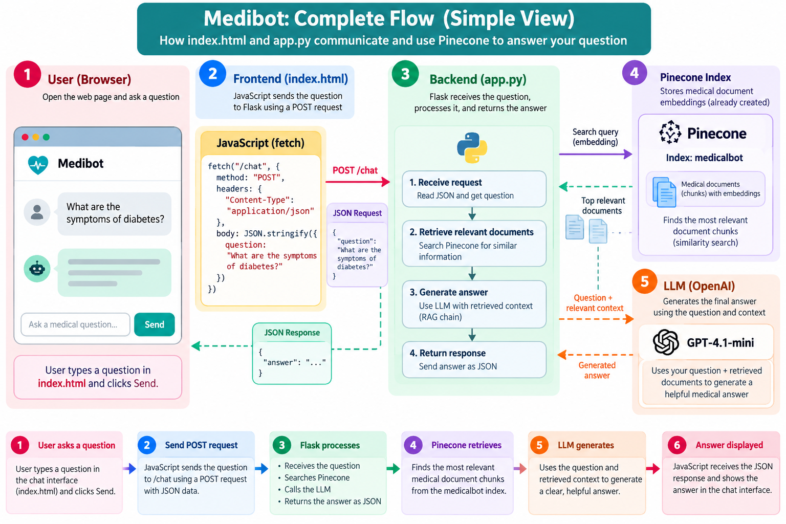

# 🩺 Medibot — Medical Information Chatbot (RAG)

Medibot is a **Retrieval-Augmented Generation (RAG)** chatbot that answers medical questions using a medical reference book as its knowledge base. It's built with **LangChain**, **Pinecone**, **Hugging Face embeddings**, **OpenAI GPT-4.1-mini** and **Flask**. It ships as a **Docker** image and deploys to **AWS EC2** through a **GitHub Actions** CI/CD pipeline.

> ⚠️ **Disclaimer:** Medibot only provides general medical information for educational purposes. It does not diagnose conditions or prescribe medication, and it is not a substitute for professional medical advice. In an emergency, contact your local emergency services.

---

## 📑 Table of Contents

- [Features](#-features)
- [Architecture](#-architecture)
- [Tech Stack](#-tech-stack)
- [Project Structure](#-project-structure)
- [Getting Started](#-getting-started)
- [Building the Vector Index](#-building-the-vector-index)
- [Running the App](#-running-the-app)
- [API Reference](#-api-reference)
- [Docker](#-docker)
- [CI/CD Deployment to AWS](#-cicd-deployment-to-aws)
- [Configuration](#-configuration)
- [License](#-license)

---

## ✨ Features

- **Answers grounded in documents:** relevant passages are retrieved from the medical book before the LLM answers.
- **Hybrid knowledge with guardrails:** the system prompt tells the model to:
  - use the retrieved context first and say clearly when it adds general knowledge,
  - point out disagreements between sources instead of merging them silently,
  - never invent citations,
  - never diagnose or prescribe,
  - put urgent medical help first when a question sounds like an emergency.
- **Local embeddings:** text is embedded on the CPU with `BAAI/bge-base-en-v1.5` (768 dimensions). Embedding needs no API cost.
- **Serverless vector search:** a Pinecone index (cosine similarity, AWS `us-east-1`) stores the vectors.
- **Chat UI:** a clean, responsive single-page interface with suggested starter questions.
- **Automated deployment:** every push to `main` builds the Docker image, pushes it to Amazon ECR and runs it on an EC2 instance.

---

## 🏗 Architecture

### Request flow



### Indexing and query pipeline

```
                ┌──────────────────────── Indexing (one-time) ────────────────────────┐
                │                                                                      │
 data/*.pdf ──► PyPDFLoader ──► filter metadata ──► RecursiveCharacterTextSplitter ──►  │
                │              (page, source)       (chunk 500, overlap 20)            │
                │                                                                      │
                │        ──► HuggingFace Embeddings (bge-base-en-v1.5) ──► Pinecone   │
                └──────────────────────────────────────────────────────────────────────┘

                ┌──────────────────────── Query (runtime) ────────────────────────────┐
                │                                                                      │
 User ──► Flask /chat ──► Retriever (top-k = 4) ──► Prompt (system + context) ──►      │
                │                                                                      │
                │        ──► ChatOpenAI (gpt-4.1-mini, temp 0.6) ──► JSON answer ──► UI │
                └──────────────────────────────────────────────────────────────────────┘
```

1. **Ingestion** ([src/store_index.py](src/store_index.py)): loads every PDF in `data/`, keeps only the `page` and `source` metadata, splits the text into chunks, embeds the chunks and upserts them into Pinecone.
2. **Retrieval + generation** ([app.py](app.py)): connects to the existing Pinecone index, finds the 4 most similar chunks for each question, "stuffs" them into the prompt and asks the LLM for an answer.

---

## 🧰 Tech Stack

| Layer            | Technology                                                    |
| ---------------- | ------------------------------------------------------------- |
| Language         | Python 3.12                                                   |
| Web framework    | Flask 3                                                       |
| LLM framework    | LangChain (`langchain`, `langchain-classic`, `langchain-core`) |
| LLM              | OpenAI `gpt-4.1-mini`                                         |
| Embeddings       | Hugging Face `BAAI/bge-base-en-v1.5` via `sentence-transformers` |
| Vector database  | Pinecone (serverless)                                         |
| PDF parsing      | `pypdf` / LangChain `PyPDFLoader`                             |
| Containerization | Docker                                                        |
| CI/CD            | GitHub Actions → Amazon ECR → Amazon EC2 (self-hosted runner) |

---

## 📁 Project Structure

```
Medical-Chatbot-/
├── .github/workflows/cicd.yaml   # CI/CD pipeline (build → ECR → EC2)
├── assets/
│   └── medibot-flow.png          # Request-flow diagram used in this README
├── data/
│   └── Medical_book.pdf          # Knowledge-base source document
├── research/
│   └── trials.ipynb              # Experiments / prototyping notebook
├── src/
│   ├── __init__.py
│   ├── helper.py                 # PDF loading, filtering, chunking, embeddings
│   ├── prompt.py                 # System prompt for the assistant
│   └── store_index.py            # Builds and populates the Pinecone index
├── templates/
│   └── index.html                # Chat front end
├── app.py                        # Flask app + RAG chain
├── dockerfile                    # Container image definition
├── requirements.txt              # Python dependencies
├── setup.py                      # Package metadata
├── template.sh                   # Script that scaffolds the project layout
└── LICENSE                       # Apache 2.0
```

---

## 🚀 Getting Started

### Prerequisites

- Python **3.10+** (3.12 recommended)
- A [Pinecone](https://www.pinecone.io/) account and API key
- An [OpenAI](https://platform.openai.com/) API key
- (Optional) Conda, Docker, and an AWS account for deployment

### 1. Clone the repository

```bash
git clone https://github.com/dhanushkapg/Medical-Chatbot-.git
cd Medical-Chatbot-
```

### 2. Create and activate an environment

```bash
conda create -n medicalbot python=3.12 -y
conda activate medicalbot
```

### 3. Install the dependencies

```bash
pip install -r requirements.txt
```

### 4. Configure the environment variables

Create a `.env` file in the project root:

```env
PINECONE_API_KEY="your-pinecone-api-key"
OPENAI_API_KEY="your-openai-api-key"
```

---

## 📚 Building the Vector Index

Run the ingestion script once, or again whenever you add PDFs to `data/`:

```bash
python src/store_index.py
```

The script will:

1. Create the Pinecone index if it does not exist yet (dimension `768`, metric `cosine`, serverless on AWS `us-east-1`).
2. Load and chunk every PDF in `data/`.
3. Embed the chunks and store them in Pinecone.

> **Note:** `src/store_index.py` creates an index named `medicalbottest`, but `app.py` reads from an index named `medicalbot`. Make the two names match before you run the app.
>
> `src/helper.py` also changes the working directory to a hard-coded local path (`os.chdir(...)`). Update or remove that line to match your machine.

---

## 💬 Running the App

```bash
python app.py
```

Open **http://127.0.0.1:5000** in your browser and start asking questions, for example:

- *What is HIV?*
- *Explain blood pressure*
- *What is type 2 diabetes?*

---

## 🔌 API Reference

### `GET /`

Serves the chat interface (`templates/index.html`).

### `POST /chat`

Sends a question to the RAG chain and returns the generated answer.

**Request**

```json
{ "question": "What are the symptoms of anemia?" }
```

**Responses**

| Status | Body                                                                      | When                         |
| ------ | ------------------------------------------------------------------------- | ---------------------------- |
| `200`  | `{ "answer": "..." }`                                                     | Success                      |
| `400`  | `{ "error": "Please enter a question." }`                                 | Empty or missing `question`  |
| `500`  | `{ "error": "Sorry, I couldn't generate an answer. Please try again." }`  | Retrieval or LLM failure     |

**Example**

```bash
curl -X POST http://127.0.0.1:5000/chat \
  -H "Content-Type: application/json" \
  -d '{"question": "What is hypertension?"}'
```

---

## 🐳 Docker

Build and run the container locally:

```bash
docker build -t medical-chatbot .
docker run -d \
  -e PINECONE_API_KEY="your-pinecone-api-key" \
  -e OPENAI_API_KEY="your-openai-api-key" \
  -p 8080:8080 \
  medical-chatbot
```

> **Note:** The container maps port `8080`, but `app.run(debug=True)` listens on `127.0.0.1:5000` by default. For the app to be reachable from outside the container, start it with `app.run(host="0.0.0.0", port=8080)`.

---

## ☁️ CI/CD Deployment to AWS

The workflow in [.github/workflows/cicd.yaml](.github/workflows/cicd.yaml) runs on every push to `main`:

1. **Continuous Integration** (`ubuntu-latest`)
   - Checks out the code
   - Configures AWS credentials and logs in to Amazon ECR
   - Builds the Docker image and pushes it to ECR with the `latest` tag
2. **Continuous Deployment** (a `self-hosted` runner on EC2)
   - Logs in to ECR
   - Pulls the image and runs it on port `8080`, passing in the API keys as environment variables

### AWS setup

1. Create an **IAM user** with the `AmazonEC2ContainerRegistryFullAccess` and `AmazonEC2FullAccess` policies.
2. Create an **ECR repository** for the image.
3. Launch an **EC2 instance** (Ubuntu) and install Docker:
   ```bash
   sudo apt-get update -y && sudo apt-get upgrade -y
   curl -fsSL https://get.docker.com -o get-docker.sh
   sudo sh get-docker.sh
   sudo usermod -aG docker ubuntu
   newgrp docker
   ```
4. Register the EC2 instance as a **self-hosted GitHub Actions runner** (*Settings → Actions → Runners → New self-hosted runner*).
5. Open port **8080** in the instance's security group.

### Required GitHub secrets

| Secret                  | Description                         |
| ----------------------- | ----------------------------------- |
| `AWS_ACCESS_KEY_ID`     | IAM user access key                 |
| `AWS_SECRET_ACCESS_KEY` | IAM user secret key                 |
| `AWS_DEFAULT_REGION`    | AWS region, e.g. `us-east-1`        |
| `ECR_REPO`              | Name of the ECR repository          |
| `PINECONE_API_KEY`      | Pinecone API key                    |
| `OPENAI_API_KEY`        | OpenAI API key                      |

---

## ⚙️ Configuration

The main settings and where to find them:

| Setting               | Value                     | File                                   |
| --------------------- | ------------------------- | -------------------------------------- |
| Pinecone index name   | `medicalbot`              | [app.py](app.py)                       |
| Retriever top-k       | `4`                       | [app.py](app.py)                       |
| LLM model             | `gpt-4.1-mini`            | [app.py](app.py)                       |
| LLM temperature       | `0.6`                     | [app.py](app.py)                       |
| Embedding model       | `BAAI/bge-base-en-v1.5`   | [src/helper.py](src/helper.py)         |
| Chunk size / overlap  | `500` / `20`              | [src/helper.py](src/helper.py)         |
| System prompt         | Medical assistant rules   | [src/prompt.py](src/prompt.py)         |

---

## 📄 License

This project is licensed under the **Apache License 2.0**. See [LICENSE](LICENSE) for details.

---

## 👤 Author

**Dhanushka Gunasinghe** — [GitHub](https://github.com/dhanushkapg)
